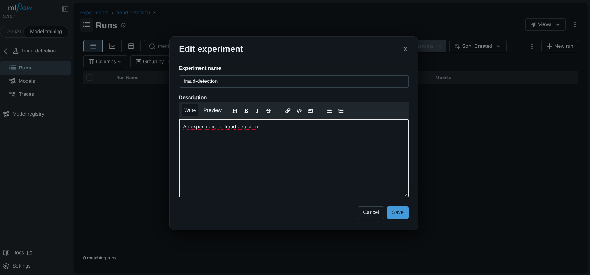
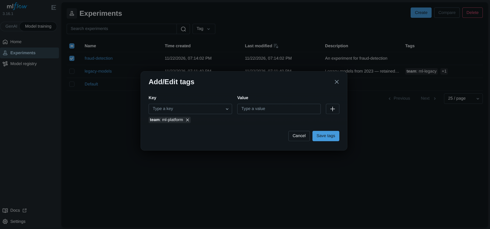
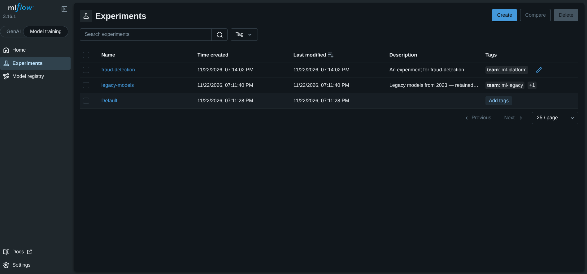
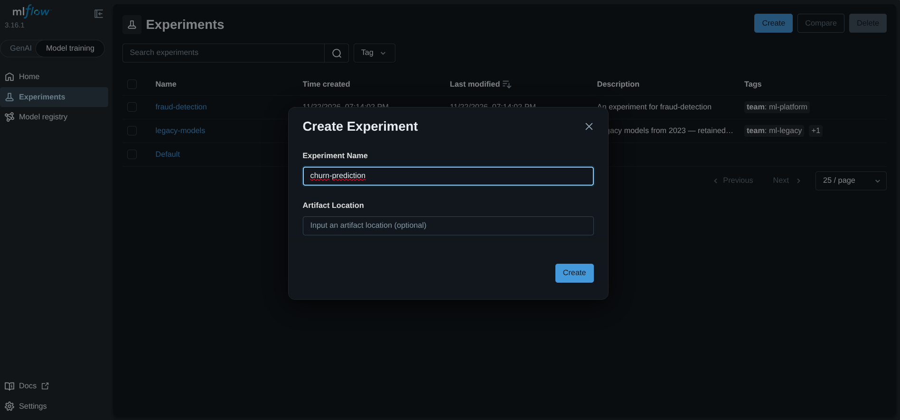
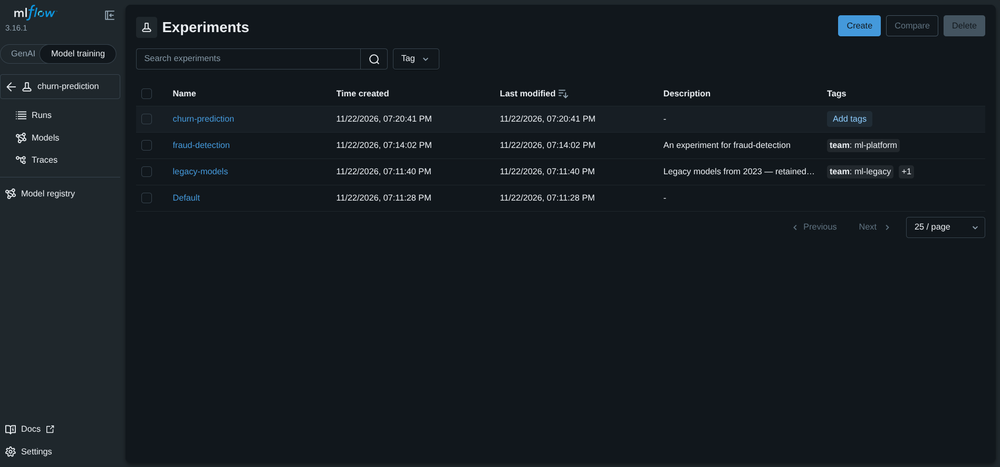
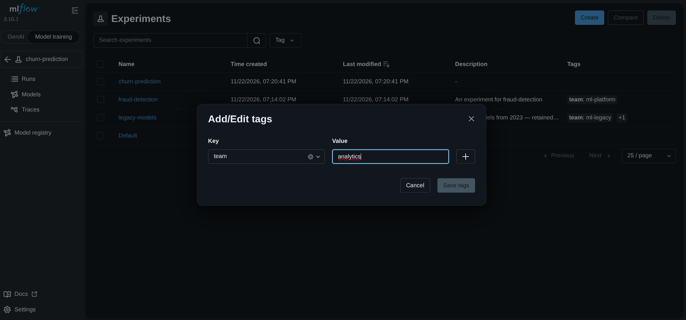
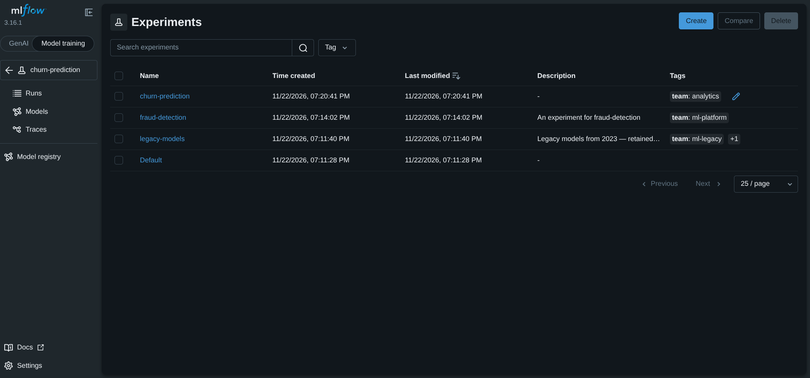

# Day 22 — Registering Experiments and Team Tags via the MLflow UI

## Problem

The xFusionCorp Industries ML platform team is onboarding two new ML
projects and needs each one organised under its own MLflow experiment
rather than sharing the Default experiment. Your task is to register both
experiments through the MLflow UI and tag them with the owning team.

The MLflow tracking server is already running on port 5000. The MLflow UI
button at the top of the lab can be opened to view the dashboard. One
seeded experiment (legacy-models) is listed alongside the
platform-created Default—both act as reference material and must not be
modified.

Using the MLflow UI, register two new experiments with the
experiment-level metadata below. The task is complete when both records
satisfy every bullet.

fraud-detection

- Experiment-level description is a non-empty string describing the
  project (any phrasing).
- Experiment-level tag: key `team`, value `ml-platform`.

churn-prediction

- Experiment-level tag: key `team`, value `analytics`.

The result can be confirmed in the MLflow UI: both new experiments appear
in the left-hand list, with the description and tags visible on each
experiment's page.

## Overview

Pure UI exercise on MLflow 3.16: two experiments created through the
dashboard, each carrying an experiment-level `team` tag. Only
`fraud-detection` also needs a description. The seeded `legacy-models`
experiment — which already shows `team: ml-legacy` — and `Default` are
reference data and must stay untouched.

## Task

| Experiment | Description | Tag |
| --- | --- | --- |
| `fraud-detection` | any non-empty string | `team` = `ml-platform` |
| `churn-prediction` | — | `team` = `analytics` |

## Solution

### 1. Create `fraud-detection`

**Experiments** page → **Create** → Experiment Name `fraud-detection`
(Artifact Location left empty). Then open the experiment, click the edit
pencil, and set a description — any non-empty phrasing qualifies:

### 2. Add the `team: ml-platform` tag

Back on the Experiments list, select the `fraud-detection` row and open
**Add/Edit tags**. Enter Key `team`, Value `ml-platform`, confirm with
the **+** button so the tag appears as a chip, then **Save tags**:

The row now shows both the description and the tag:

### 3. Create `churn-prediction`

Same flow — **Create** → Experiment Name `churn-prediction` → Create:

The new experiment appears at the top of the list:

### 4. Add the `team: analytics` tag

Select the `churn-prediction` row → **Add/Edit tags** → Key `team`,
Value `analytics` → **+** → **Save tags**:

### 5. Final state

Both experiments registered with their tags; `legacy-models` and
`Default` untouched:

## Gotchas

### Experiment tags ≠ run tags

Tags must be added at **experiment level**: select the experiment *row*
on the Experiments list and use **Add/Edit tags** there (or the pencil on
the experiment page). Tags added inside a run are run-scoped and do not
satisfy the requirement.

### The tag must be committed as a chip before saving

In the **Add/Edit tags** dialog, typing the key and value is not enough —
press **+** (or Enter) so the pair becomes a chip, *then* click **Save
tags**. Saving with the pair still sitting in the input fields applies
nothing.

### Description lives in the edit dialog, not the tag panel

The experiment description is a dedicated metadata field (edit pencil on
the experiment page), not a tag — don't try to express it as
`description: ...` in the tag list.

## Further reading

- MLflow experiments & tags — <https://mlflow.org/docs/latest/ml/tracking/tracking-api/#manage-experiments-and-runs>
- REST equivalents: `mlflow.create_experiment`, `mlflow.set_experiment_tag` — useful when UI access is unavailable
